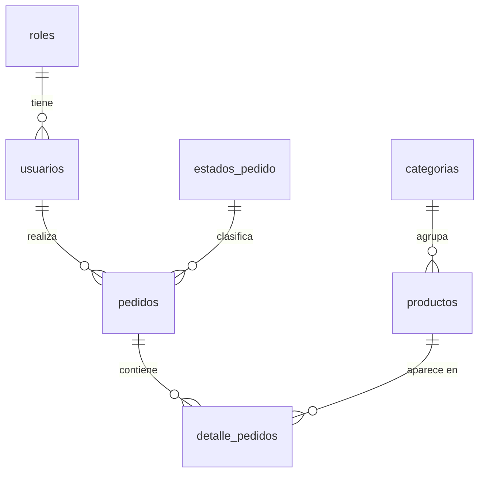

# Normalización – Librería Quin (TP6, Parte 1)

Sistema: tienda web de librería (catálogo de productos, usuarios y pedidos).

## 1. Entidad principal sin normalizar

Registro hipotético de un **pedido** tal como podría guardarse en una única tabla/planilla:

| id_pedido | cliente | email | teléfonos | rol | fecha | estado | productos_comprados | categorías | total |
|---|---|---|---|---|---|---|---|---|---|
| 1 | Camila Pérez | camila@ejemplo.test | 3875550002, 3875550099 | cliente | 2026-11-03 | pendiente | Kit Escolar Completo x1 ($20.500); Combo Estudiantil x2 ($6.500) | Kits escolares; Kits escolares | 33.500 |

Problemas detectados:
- **Campos multivalorados:** `teléfonos`, `productos_comprados` y `categorías` guardan varias cosas en una sola celda.
- **Redundancia:** el nombre/email del cliente se repetiría en cada pedido; el nombre de la categoría y el estado se repetirían como texto en cada fila.

## 2. Proceso de normalización

### Primera Forma Normal (1FN) – campos atómicos

Se separa cada ítem del pedido en su propia fila y se deja un solo teléfono por usuario
(si hiciera falta más de uno se crearía una tabla `telefonos_usuario`). Clave primaria compuesta: `(id_pedido, id_producto)`.

| **id_pedido** | **id_producto** | cantidad | cliente | email | telefono | rol | fecha | estado | producto | categoría | precio_unitario |
|---|---|---|---|---|---|---|---|---|---|---|---|
| 1 | 1 | 1 | Camila Pérez | camila@ejemplo.test | 3875550002 | cliente | 2026-11-03 | pendiente | Kit Escolar Completo | Kits escolares | 20.500 |
| 1 | 2 | 2 | Camila Pérez | camila@ejemplo.test | 3875550002 | cliente | 2026-11-03 | pendiente | Combo Estudiantil | Kits escolares | 6.500 |

### Segunda Forma Normal (2FN) – sin dependencias parciales

Con la clave `(id_pedido, id_producto)` hay columnas que dependen de solo una parte:

- Dependen solo de `id_pedido`: cliente, email, teléfono, rol, fecha, estado.
- Dependen solo de `id_producto`: producto, categoría, precio.
- Dependen de la clave completa: `cantidad` (y el `precio_unitario` histórico pagado).

Se descompone en tres tablas: `pedidos`, `productos` y `detalle_pedidos`.

### Tercera Forma Normal (3FN) – sin dependencias transitivas

- En `pedidos`: `cliente, email, teléfono, rol` dependen de `usuario` (no de la clave del pedido) → se extraen a **`usuarios`**; el `rol` pasa a la tabla **`roles`**.
- En `pedidos`: `estado` es un texto repetido → tabla **`estados_pedido`**.
- En `productos`: `categoría` depende de la categoría, no del producto → tabla **`categorias`**.

## 3. Tablas resultantes

| Tabla | PK | FK | Descripción |
|---|---|---|---|
| `roles` | `id` | – | Roles de usuario (administrador, cliente) |
| `categorias` | `id` | – | Categorías de producto |
| `estados_pedido` | `id` | – | Estados del pedido (pendiente, pagado, enviado…) |
| `usuarios` | `id` | `rol` → `roles.nombre` | Autenticación (email, password con hash bcrypt), rol (`admin` / `usuario`) y datos personales |
| `productos` | `id` | `categoria_id` → `categorias.id` | Tabla principal del negocio (CRUD del TP7) |
| `pedidos` | `id` | `usuario_id` → `usuarios.id`, `estado_id` → `estados_pedido.id` | Cabecera del pedido |
| `detalle_pedidos` | `id` (único `pedido_id + producto_id`) | `pedido_id` → `pedidos.id`, `producto_id` → `productos.id` | Relación N:M pedidos–productos |

### Diagrama de relaciones

